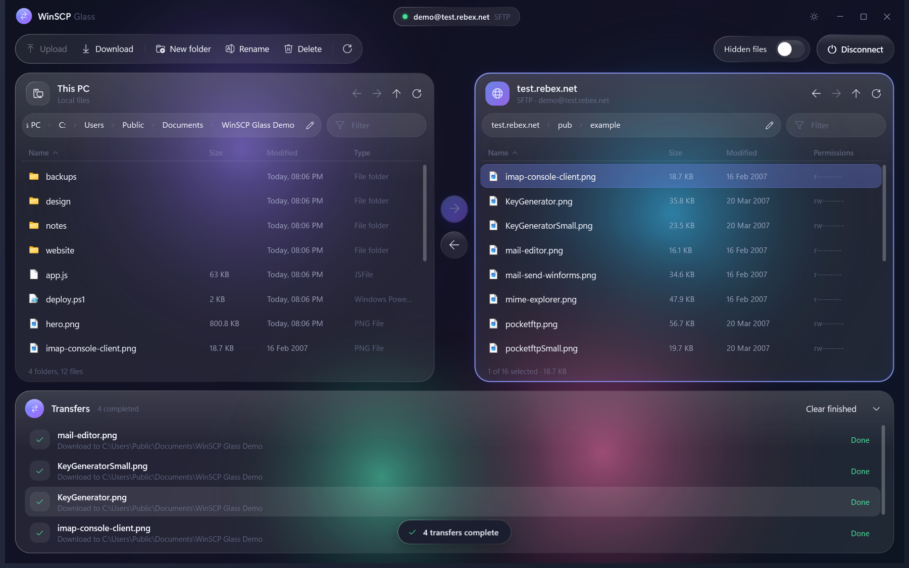
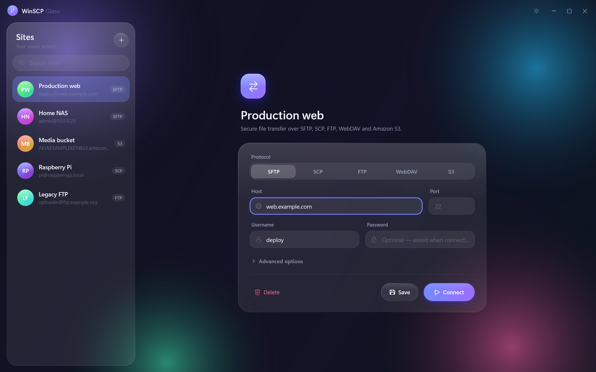
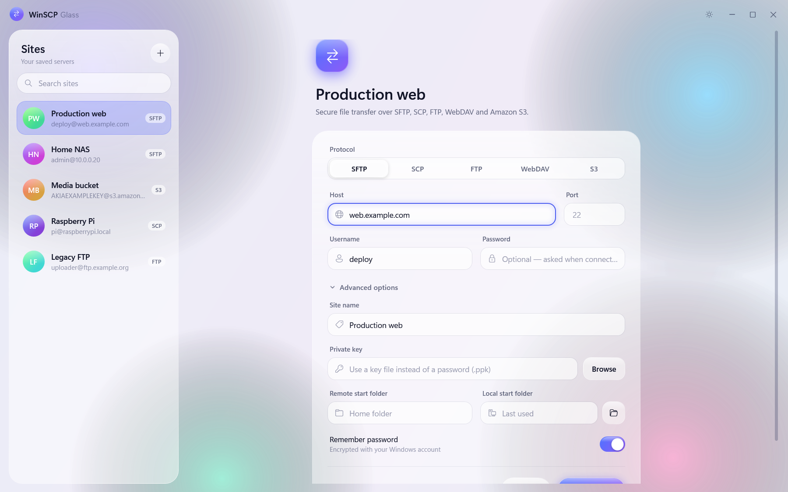
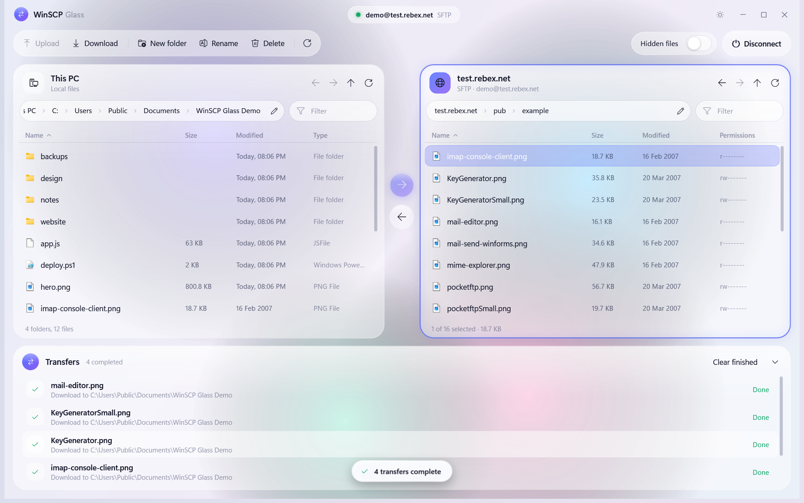
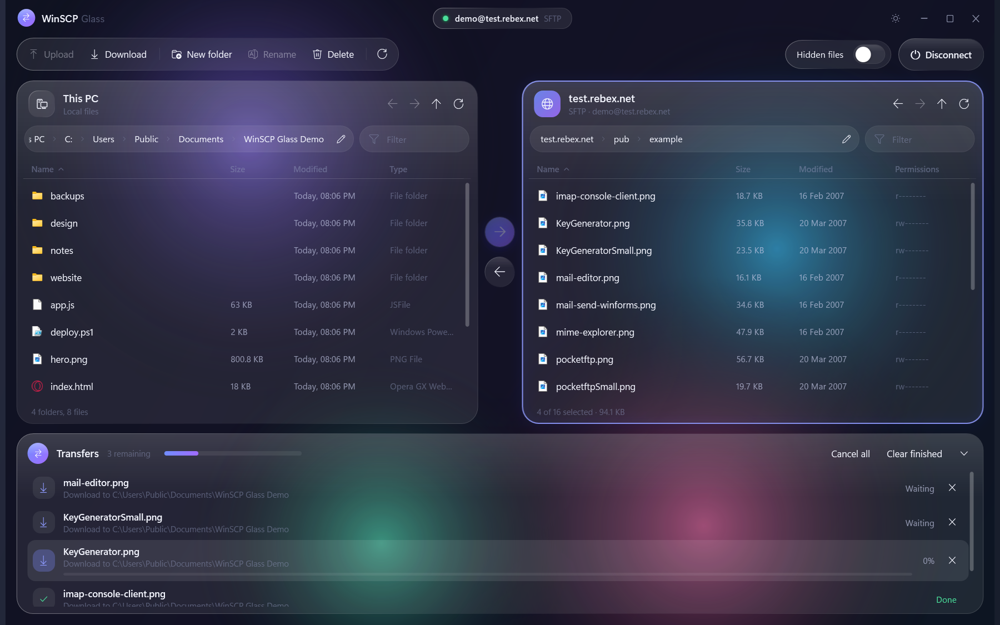
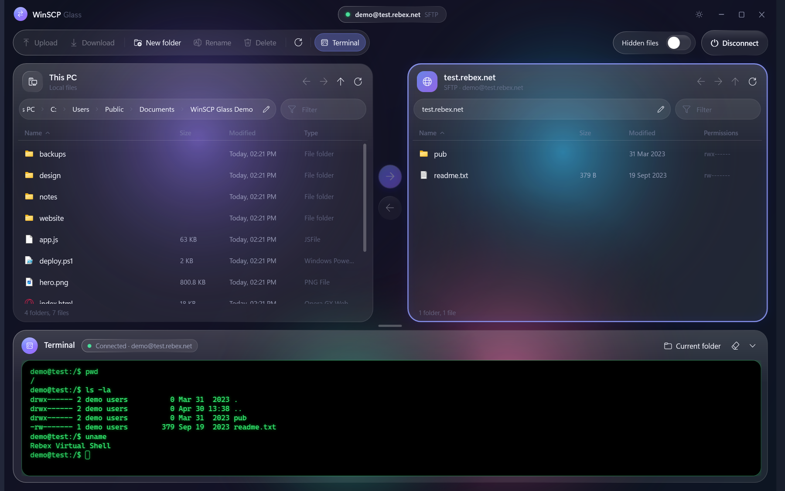
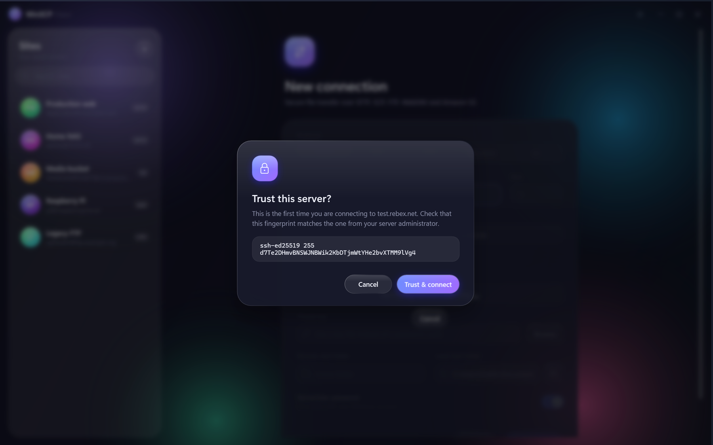
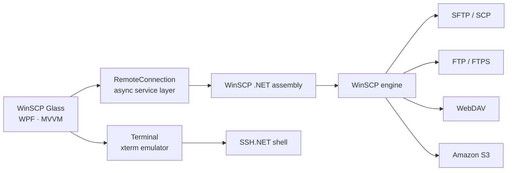

<div align="center">


<br/><br/>

<a href="https://github.com/byadnesh/WinSCP-Glass">
  
</a>

<br/><br/>

<p>
  
  
  
  
</p>

<p>
  
  
  
  
  
</p>

<p>
  <a href="#overview">Overview</a> &nbsp;·&nbsp;
  <a href="#features">Features</a> &nbsp;·&nbsp;
  <a href="#screenshots">Screenshots</a> &nbsp;·&nbsp;
  <a href="#installation">Installation</a> &nbsp;·&nbsp;
  <a href="#architecture">Architecture</a> &nbsp;·&nbsp;
  <a href="#acknowledgements">Acknowledgements</a>
</p>

<br/>



</div>

<br/>

## Overview

WinSCP Glass is a modern desktop file transfer client for Windows. It reimagines the classic WinSCP experience with a translucent, liquid-glass interface inspired by visionOS.

It connects to servers over SFTP, SCP, FTP/FTPS, WebDAV and Amazon S3, and shows local and remote files side by side in a two-panel workspace. Files move by drag and drop or a single keystroke. A live transfer queue reports progress and speed for every file, and lets you cancel or retry. Remote files can be edited in place: they open in their default application and upload again every time you save. For SSH servers, a built-in terminal opens an interactive shell with the same login, so you can run commands without leaving the app. Security is built in. SSH host keys are verified on first use, and saved credentials are encrypted with Windows DPAPI.

The application is written in C# with WPF on .NET 9 and follows an MVVM architecture. A custom glass design system sits on top of an asynchronous service layer that wraps the official WinSCP .NET engine. Protocol handling therefore comes from the same proven code WinSCP itself uses, presented through an interface designed to be fast, calm and easy to use.

## Features

**Interface**

- Translucent glass surfaces with light-catching edges and specular highlights.
- On Windows 11, a genuine acrylic backdrop: the desktop shows through the window, blurred.
- Ambient light fields that drift slowly behind the glass.
- Spring-based motion: controls respond to hover and press, and dialogs float in over a blurred backdrop.
- Dark and light themes, switchable at any time.

**Connectivity**

- SFTP and SCP over SSH, including private key authentication.
- FTP with explicit or implicit TLS, in passive or active mode.
- WebDAV over HTTP or HTTPS.
- Amazon S3 and S3-compatible object storage.
- Saved sites with search and per-site start folders. Accepts `user@host:port` input exactly as `ssh` does.

**File management**

- Two-panel browser for local and remote files.
- Breadcrumb navigation with direct path entry.
- Instant filtering, natural sorting with folders first, and back, forward and up navigation.
- Drag and drop between panels, or from Windows Explorer onto the server.
- Native Windows file-type icons throughout.

**Built-in terminal**

- Interactive SSH shell that signs in automatically with the same credentials as the SFTP or SCP session.
- Verifies the server against the host key you already trusted, so there is no second prompt.
- Cyberpunk display on a black screen: neon green text by default, with neon red, yellow, blue, magenta and cyan wherever programs use colour, plus a soft glow and CRT scanlines.
- Full xterm emulation: colours, cursor addressing and full-screen programs such as `htop`, `nano`, `vim` and `less`.
- Copy and paste, mouse selection, 5,000 lines of scrollback, and automatic resizing.
- **Current folder** and **Open in terminal** jump the shell to the folder open in the server panel.

**Transfers**

- Sequential transfer queue showing progress and speed for each file.
- Cancel, retry and clear-finished controls.
- Conflict resolution: replace existing files or skip them.
- In-place editing of remote files with automatic upload on save.

**Security**

- Trust-on-first-use verification of SSH host keys, with a clear warning if a key changes.
- Optional password storage, encrypted with Windows DPAPI and bound to the current Windows account.
- Local deletions go to the Recycle Bin. Remote deletions always ask for confirmation first.

## Screenshots

<table>
  <tr>
    <td width="50%"></td>
    <td width="50%"></td>
  </tr>
  <tr>
    <td align="center"><sub>Connection screen, dark theme</sub></td>
    <td align="center"><sub>Connection screen, light theme</sub></td>
  </tr>
  <tr>
    <td width="50%"></td>
    <td width="50%"></td>
  </tr>
  <tr>
    <td align="center"><sub>File browser, light theme</sub></td>
    <td align="center"><sub>Transfer queue</sub></td>
  </tr>
  <tr>
    <td colspan="2"></td>
  </tr>
  <tr>
    <td colspan="2" align="center"><sub>Built-in SSH terminal</sub></td>
  </tr>
  <tr>
    <td width="50%"></td>
    <td width="50%"></td>
  </tr>
  <tr>
    <td align="center"><sub>Host key verification</sub></td>
    <td align="center"><sub>File browser, dark theme</sub></td>
  </tr>
</table>

<sub>The screenshots show sample sites and the public <a href="https://test.rebex.net">Rebex test server</a>.</sub>

## Installation

### Requirements

| Component | Requirement |
| --- | --- |
| Operating system | Windows 10 or Windows 11. The acrylic backdrop needs Windows 11 22H2 or later; earlier versions use a tinted fallback. |
| SDK | [.NET 9 SDK](https://dotnet.microsoft.com/download/dotnet/9.0), needed only to build from source. |

You do not need a separate WinSCP installation. The build downloads the official [WinSCP NuGet package](https://www.nuget.org/packages/WinSCP), which includes the engine.

### Run from source

```bash
git clone https://github.com/byadnesh/WinSCP-Glass.git
cd WinSCP-Glass
dotnet run --project src/WinSCPGlass -c Release
```

### Build a portable release

```bash
dotnet publish src/WinSCPGlass -c Release -r win-x64 --self-contained -o publish
```

The `publish` folder contains `WinSCPGlass.exe` and every dependency. It runs on any 64-bit Windows PC without .NET installed.

### Visual Studio

Open `WinSCPGlass.sln` in Visual Studio 2022 with the .NET desktop development workload, then press <kbd>F5</kbd>.

## Usage

1. Select a protocol. For any server you can reach with `ssh`, choose SFTP.
2. Enter the host, username and password. Leave the port empty to use the protocol's default.
3. Select **Connect**. On first connection, compare the server's fingerprint with the one you expect, then choose **Trust & connect**.
4. Browse with double-click or the breadcrumb bar. Transfer files with **Upload** or **Download**, the arrow controls, <kbd>Ctrl</kbd>+<kbd>U</kbd>, or drag and drop.
5. Select **Save** to keep the connection in the sites list.

Settings are stored in `%AppData%\WinSCP Glass\settings.json`. To store them elsewhere, for example for a portable installation, set the `WINSCP_GLASS_SETTINGS_DIR` environment variable.

### Keyboard shortcuts

| Shortcut | Action |
| --- | --- |
| <kbd>Enter</kbd> | Open the selected folder or file |
| <kbd>Backspace</kbd>, <kbd>Alt</kbd>+<kbd>Up</kbd> | Go up one level |
| <kbd>Alt</kbd>+<kbd>Left</kbd>, <kbd>Alt</kbd>+<kbd>Right</kbd> | Go back, go forward |
| <kbd>Ctrl</kbd>+<kbd>U</kbd> | Copy the selection to the opposite panel |
| <kbd>F2</kbd> | Rename |
| <kbd>Delete</kbd> | Delete |
| <kbd>Ctrl</kbd>+<kbd>Shift</kbd>+<kbd>N</kbd> | New folder |
| <kbd>F5</kbd> | Refresh |
| <kbd>Ctrl</kbd>+<kbd>F</kbd> | Filter the current folder |
| <kbd>Ctrl</kbd>+<kbd>L</kbd> | Enter a path |
| <kbd>Tab</kbd> | Switch between panels |
| <kbd>Ctrl</kbd>+<kbd>`</kbd> | Show or hide the terminal |
| <kbd>Ctrl</kbd>+<kbd>Shift</kbd>+<kbd>C</kbd>, <kbd>Ctrl</kbd>+<kbd>V</kbd> | Copy and paste in the terminal |

## Architecture

WinSCP Glass provides the interface; WinSCP provides the engine. The application talks to the official WinSCP .NET assembly, which drives `WinSCP.exe` in the background. All operations are asynchronous and serialized through a single service, so the interface stays responsive during long transfers.



<p align="center">
  
</p>

| Layer | Technology |
| --- | --- |
| Presentation | WPF, with a custom glass design system and no third-party UI framework |
| Application | MVVM with CommunityToolkit.Mvvm |
| Platform | DWM interop for the acrylic backdrop, Windows Shell for icons and the Recycle Bin, DPAPI for credentials |
| Transfer engine | WinSCP .NET assembly and `WinSCP.exe` |
| Terminal | SSH.NET interactive shell with a custom xterm-compatible emulator and renderer |

### Project structure

```
WinSCP-Glass/
├── src/WinSCPGlass/
│   ├── App.xaml               Application startup, theming and error handling
│   ├── MainWindow.xaml        Glass window, title bar, dialog layer and notifications
│   ├── Themes/                Dark and light colour tokens
│   ├── Styles/                Glass design system (control templates)
│   ├── Controls/              Attached properties, converters, window glass, transitions
│   ├── Models/                Sites, settings and file entries
│   ├── Services/              WinSCP connection service and shell integration
│   ├── ViewModels/            Application logic
│   ├── Terminal/              xterm emulator and the neon terminal renderer
│   ├── Views/                 Connection, session, file panel and dialog views
│   └── Diagnostics/           Debug-only screenshot tooling
├── docs/                      Logo and screenshots
└── WinSCPGlass.sln
```

## Roadmap

- [x] Glass design system with dark and light themes
- [x] SFTP, SCP, FTP/FTPS, WebDAV and Amazon S3
- [x] Two-panel browser with drag and drop
- [x] Transfer queue with cancel and retry
- [x] In-place remote editing
- [x] Built-in SSH terminal
- [ ] Directory synchronization
- [ ] Permissions editor
- [ ] Tabbed sessions
- [ ] Installer and automatic updates

Contributions and suggestions are welcome through issues and pull requests.

## Acknowledgements

WinSCP Glass is inspired by [WinSCP](https://winscp.net), the free and open-source file transfer client for Windows created by Martin Přikryl. WinSCP's architecture keeps protocol logic separate from the user interface, and that separation shaped this project. WinSCP Glass is a new interface built on WinSCP's public .NET assembly.

WinSCP Glass is an independent project. It is not affiliated with, or endorsed by, the WinSCP project. The name WinSCP is used only to credit the engine this application uses and the software that inspired it.

**Third-party components**

| Component | License |
| --- | --- |
| [WinSCP .NET assembly](https://winscp.net/eng/docs/library) | MPL-2.0 |
| WinSCP executable (included in the NuGet package) | GPL-3.0 |
| [CommunityToolkit.Mvvm](https://github.com/CommunityToolkit/dotnet) | MIT |
| [SSH.NET](https://github.com/sshnet/SSH.NET) | MIT |

## License

WinSCP Glass is released under the [MIT License](LICENSE). Builds include `WinSCP.exe` from the WinSCP NuGet package. That file remains under the GPL-3.0, so its license must accompany any binary distribution.

<br/>

<div align="center">

<a href="https://github.com/byadnesh"></a>


</div>
