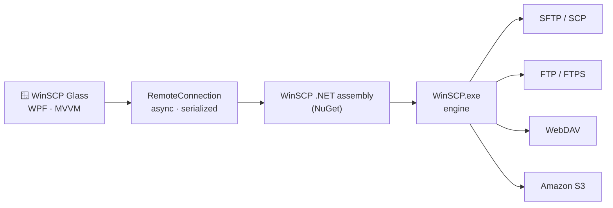

<div align="center">


# WinSCP Glass

<a href="https://github.com/byadnesh/WinSCP-Glass">
  
</a>

<p>
  
  
  
  
</p>
<p>
  
  
  
  
</p>

**WinSCP Glass** is a modern file transfer client for Windows with a translucent *liquid-glass* interface inspired by visionOS and iOS.<br/>
It is inspired by [WinSCP](https://winscp.net), and every transfer runs on WinSCP's proven engine.


</div>

---

## 📑 Contents

- [Why WinSCP Glass?](#-why-winscp-glass)
- [Features](#-features)
- [Screenshots](#-screenshots)
- [Installation](#-installation)
- [Usage](#-usage)
- [Keyboard shortcuts](#%EF%B8%8F-keyboard-shortcuts)
- [How it works](#-how-it-works)
- [Project structure](#-project-structure)
- [Roadmap](#%EF%B8%8F-roadmap)
- [Inspired by WinSCP](#-inspired-by-winscp)
- [License](#-license)
- [Author](#-author)

---

## 💡 Why WinSCP Glass?

[WinSCP](https://winscp.net) is one of the most trusted file transfer tools on Windows, but its interface dates from a very different era of desktop design.
**WinSCP Glass** asks a simple question: *what if that reliability came with an interface that feels like 2026?*

The result is a ground-up redesign:

- Translucent glass panels float over a softly moving light field.
- Controls feel springy and alive.
- The everyday tasks (connect, browse, transfer) take a click or a keystroke.

## ✨ Features

<table>
  <tr>
    <td width="50%" valign="top">

### 🪟 Liquid-glass design

- On Windows 11, the window itself is real glass: your desktop shows through it, blurred.
- Frosted panels with light-catching rims and a specular top sheen.
- Ambient light orbs drift slowly behind the glass.
- Spring animations: buttons lift and squish, switches slide like iOS, and dialogs float in over a blurred backdrop.
- 🌙 Dark and ☀️ light themes, one click apart.

</td>
<td width="50%" valign="top">

### 🔌 Protocols

- **SFTP** and **SCP** over SSH, with private key (`.ppk`) support.
- **FTP** with explicit or implicit **TLS**, in passive or active mode.
- **WebDAV** over HTTP or HTTPS.
- **Amazon S3** and S3-compatible storage.
- All powered by WinSCP's engine, so servers behave exactly as they do in WinSCP.

</td>
  </tr>
  <tr>
    <td width="50%" valign="top">

### 📂 Two-panel file browser

- Your PC on one side and the server on the other, commander-style.
- Clickable breadcrumbs. Press `Ctrl+L` to type a path.
- Instant filter, folders-first natural sorting, and back / forward / up.
- **Drag & drop** between panels, or straight from Explorer onto the server.
- Native Windows file icons.

</td>
<td width="50%" valign="top">

### 🚀 Transfers & editing

- A transfer queue with per-file progress, speed, cancel and retry.
- Conflict handling: *Replace* or *Skip existing*.
- **Edit remote files in place**: double-click a file to open it in its app, and every save uploads it back.
- Local deletes go to the Recycle Bin. Remote deletes ask for confirmation first.

</td>
  </tr>
  <tr>
    <td width="50%" valign="top">

### 🔐 Security

- SSH host keys use trust on first use: you check the fingerprint once.
- A clear warning appears if the server's key ever changes.
- Saved passwords are encrypted with **Windows DPAPI** and tied to your Windows account.

</td>
<td width="50%" valign="top">

### 🗂️ Sites

- Saved sites with coloured avatars and search.
- Per-site start folders, key files and TLS options.
- Paste `user@host:port` into the Host box, just like you would after `ssh`.

</td>
  </tr>
</table>

## 📸 Screenshots

<div align="center">

| Connect (dark) | Connect (light) |
| :---: | :---: |
|  |  |
| **File browser (dark)** | **File browser (light)** |
|  |  |
| **Verifying a server** | **Transfers in progress** |
|  |  |

</div>

> The screenshots show the public [Rebex test server](https://test.rebex.net) and sample sites. The glass effect is strongest on Windows 11 with a colourful wallpaper.

## 📦 Installation

### Requirements

| | |
| --- | --- |
| **OS** | Windows 10 or Windows 11. The see-through glass backdrop needs Windows 11 22H2 or newer; older versions get a tinted fallback. |
| **SDK** | [.NET 9 SDK](https://dotnet.microsoft.com/download/dotnet/9.0) (to build from source) |

You do **not** need to install WinSCP. The build downloads the official [WinSCP NuGet package](https://www.nuget.org/packages/WinSCP), which includes `WinSCP.exe`.

### Option 1: run from source

```bash
git clone https://github.com/byadnesh/WinSCP-Glass.git
cd WinSCP-Glass
dotnet run --project src/WinSCPGlass -c Release
```

### Option 2: build a portable app folder

```bash
dotnet publish src/WinSCPGlass -c Release -r win-x64 --self-contained -o publish
```

Then start `publish\WinSCPGlass.exe`. The `publish` folder runs on any 64-bit Windows PC without .NET installed, so you can zip it and share it.

### Option 3: Visual Studio

Open `WinSCPGlass.sln` in **Visual Studio 2022** (with the *.NET desktop development* workload) and press <kbd>F5</kbd>.

## 🧭 Usage

1. **Pick a protocol.** SFTP is the right choice for any server you can reach with `ssh`.
2. **Enter the host, username and password.** Leave **Port** empty to use the default.
3. Press **Connect**. The first time, check the server's fingerprint and choose **Trust & connect**.
4. Browse with double-click or the breadcrumbs. Move files with **Upload / Download**, the arrow buttons, `Ctrl+U`, or drag & drop.
5. Press **Save** to keep the site in your sidebar for next time.

Settings live in `%AppData%\WinSCP Glass\settings.json`. To keep them somewhere else, for example a portable USB copy, set the `WINSCP_GLASS_SETTINGS_DIR` environment variable.

## ⌨️ Keyboard shortcuts

| Keys | Action |
| --- | --- |
| <kbd>Enter</kbd> / double-click | Open folder or file |
| <kbd>Backspace</kbd> · <kbd>Alt</kbd>+<kbd>↑</kbd> | Up one level |
| <kbd>Alt</kbd>+<kbd>←</kbd> / <kbd>Alt</kbd>+<kbd>→</kbd> | Back / forward |
| <kbd>Ctrl</kbd>+<kbd>U</kbd> | Copy the selection to the other side |
| <kbd>F2</kbd> | Rename |
| <kbd>Del</kbd> | Delete |
| <kbd>Ctrl</kbd>+<kbd>Shift</kbd>+<kbd>N</kbd> | New folder |
| <kbd>F5</kbd> | Refresh |
| <kbd>Ctrl</kbd>+<kbd>F</kbd> | Filter |
| <kbd>Ctrl</kbd>+<kbd>L</kbd> | Type a path |
| <kbd>Tab</kbd> | Switch panel |
| <kbd>Esc</kbd> / <kbd>Enter</kbd> | Cancel / confirm a dialog |

## 🧠 How it works

WinSCP Glass is the **interface**; WinSCP is the **engine**.
The app talks to the official WinSCP .NET assembly, which drives `WinSCP.exe` in the background. That means the protocol handling is the same battle-tested code that WinSCP itself uses.



**Tech stack:**

- **WPF** on **.NET 9**, with a hand-written glass design system and no UI framework.
- **CommunityToolkit.Mvvm** for view models and commands.
- **DWM interop** for the Windows 11 acrylic backdrop.
- **DPAPI** for encrypting stored passwords.

## 🧱 Project structure

```
WinSCP-Glass/
├── src/WinSCPGlass/
│   ├── App.xaml(.cs)          # startup, theme switching, error handling
│   ├── MainWindow.xaml(.cs)   # glass window, title bar, dialog layer, toasts
│   ├── Themes/                # Dark.xaml / Light.xaml colour tokens
│   ├── Styles/Controls.xaml   # the glass design system (every control template)
│   ├── Controls/              # attached properties, converters, DWM glass, transitions
│   ├── Models/                # sites, settings, file entries
│   ├── Services/              # RemoteConnection (WinSCP wrapper), shell icons
│   ├── ViewModels/            # MVVM logic
│   ├── Views/                 # Connect, Session, FilePanel, DialogSheet
│   └── Diagnostics/           # debug-only screenshot runner
├── docs/                      # logo and screenshots
└── WinSCPGlass.sln
```

## 🗺️ Roadmap

- [x] Glass design system with dark and light themes
- [x] SFTP, SCP, FTP/FTPS, WebDAV and S3
- [x] Two-panel browser with drag & drop
- [x] Transfer queue with cancel and retry
- [x] Edit remote files with auto-upload
- [ ] Folder synchronisation
- [ ] Permissions (chmod) editor
- [ ] Multiple sessions in tabs
- [ ] Installer and auto-update

Ideas and pull requests are welcome!

## 🙏 Inspired by WinSCP

This project is inspired by **[WinSCP](https://winscp.net)**, the free, open-source SFTP, FTP, WebDAV and S3 client for Windows created by **Martin Přikryl**.
Studying WinSCP's architecture shaped this app. Its core keeps protocol logic (`TTerminal` and a file-system class per protocol) cleanly separated from the user interface. WinSCP Glass builds a brand-new interface on top of WinSCP's public .NET assembly.

> **Disclaimer:** WinSCP Glass is an independent personal project. It is **not affiliated with or endorsed by** the WinSCP project. "WinSCP" is used only to credit the engine this app is built on and the software that inspired it.

**Third-party components:**

- [WinSCP .NET assembly](https://winscp.net/eng/docs/library): MPL-2.0. It is downloaded via NuGet at build time and includes `WinSCP.exe`, which is GPL-3.0.
- [CommunityToolkit.Mvvm](https://github.com/CommunityToolkit/dotnet): MIT.

## 📄 License

The WinSCP Glass source code is released under the [MIT License](LICENSE).<br/>
If you distribute a build, it includes `WinSCP.exe` from the WinSCP NuGet package. That file stays under its own GPL-3.0 licence, so ship its licence alongside it.

## 👤 Author

<div align="center">

**Yadnesh Bhagwat**

<a href="https://github.com/byadnesh"></a>

If you like this project, consider giving it a ⭐. It really helps!

</div>
